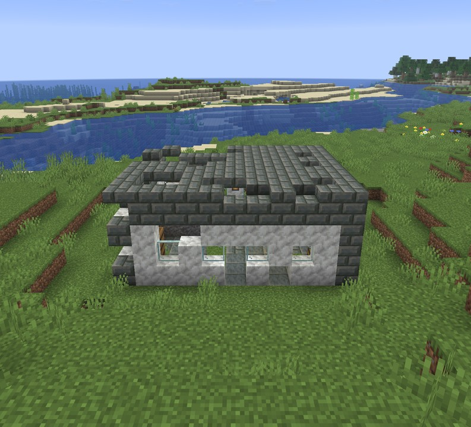
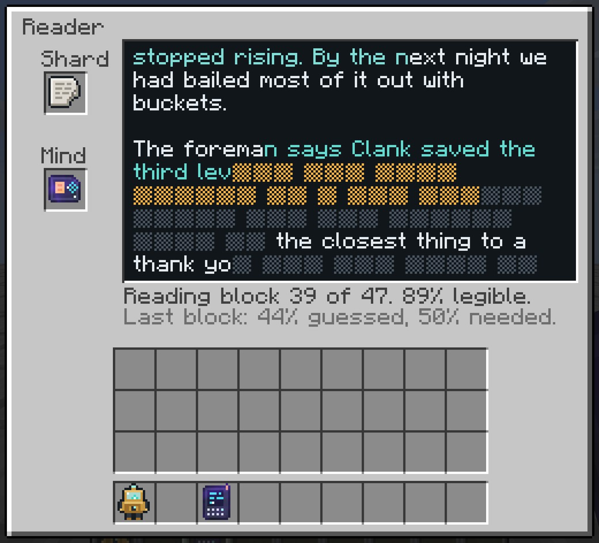
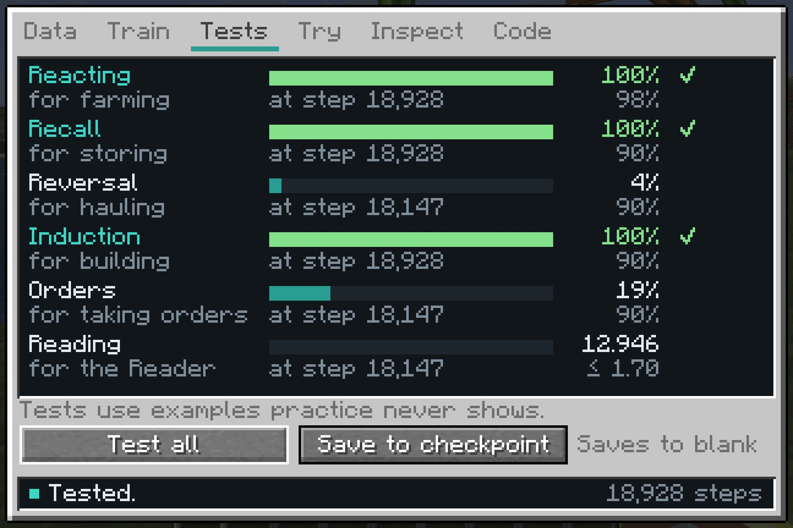
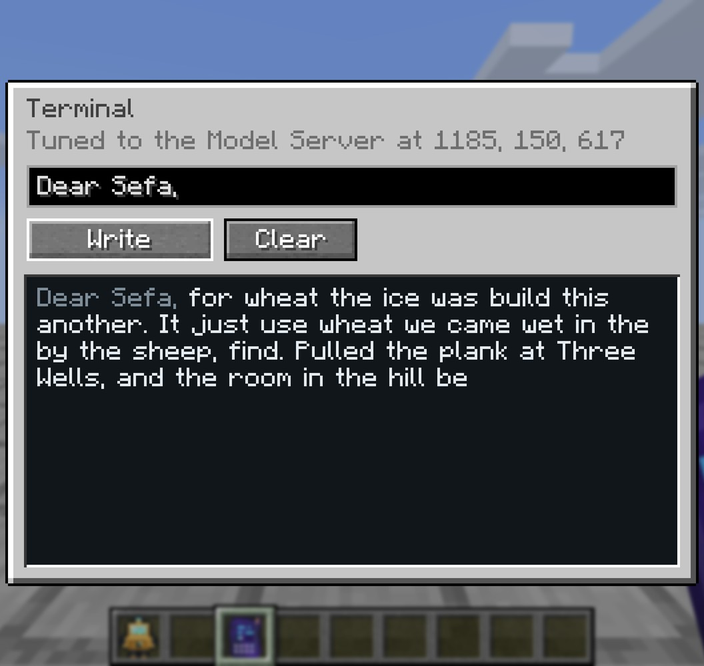

<div align="center">


**Build models from the ground up, one block at a time.**

</div>


Someone lived in this world before you. They built machines that thought, and they wrote everything down. Then they
were gone, and nothing they left says why. Their writing survives in the ruins as broken shards.

Residual is a Minecraft mod about building those models again, and every model is a real language model. Each machine
performs one real operation: a table lookup, a matrix multiplication, a softmax, a whole transformer layer. Cable
machines into a network, train it on text, test it on text it has never seen, and put it to work in the body of an
agent. The arithmetic is what PyTorch does, down to the optimizer.

## The archive

<p>


</p>

Archive houses, relay masts and buried vaults stand far apart across the overworld. They hold archive shards, the
schematics of machines whose plans were lost, and salvaged models that no longer work.

A shard is one record of the old world's archive, a letter or a journal, a story, a song, a manual or a notice, with
some of its text worn away. Filed into an Archive Drive, what you recover becomes something to learn from: a model that
practises on it learns to read the way the old world wrote. A Reader restores lost text with a model of your own, and a
lost block comes back only if your model can predict it. Each restored block is more text to learn from.

Models start out reading one character at a time. A BPE Forge learns a vocabulary from the text you have recovered,
merging the most frequent pair of tokens over and over, and writes it onto a Tokenizer. A model that reads with it sees
words where it used to see letters. Losses are counted per character, so models with different tokenizers compare
fairly.

## Models

<p>


</p>

Every model is tested on eight benchmarks. A test uses examples that practice never shows, and a job asks its model in
exactly the test's format, so a test score is how often an agent decides right.

| Benchmark   | Practice      | Passes at   | Put to work                  |
| --------- | ------------- | ----------- | ---------------------------- |
| Reacting  | Field Dataset   | 98%         | farming                      |
| Forecasting | Growth Dataset | loss ≤ 0.23 | running a field ahead        |
| Recall    | Storage Dataset | 90%         | keeping a storeroom          |
| Reversal  | Errand Dataset  | 90%         | hauling                      |
| Induction | Pattern Dataset | 90%         | building                     |
| Sorting   | Sorting Dataset | 90%         | sorting things by kind       |
| Orders    | Orders Dataset  | 90%         | understanding what you say   |
| Reading   | Archive Drive | loss ≤ 1.40 | restoring the archive        |

A single embedding table can learn to farm. Recall needs attention, reversal needs to know positions, induction takes
two layers of attention, sorting has to tell what a thing is from its name alone, and understanding orders takes a model
too big to carry. The Model Core trains a model on up to four kinds of practice at once and shows the learning curves,
the tests, every machine's output shape, weights and gradient. Saving a model to a checkpoint tests it on all eight
benchmarks first.

While a model trains, waves run through its blocks: a teal pulse from the tokens to the loss as the batch goes forward,
then an amber one back as the gradient returns, each block lighting as brightly as what it carries. A block that stays
dark on the way back is hardly learning. Above every machine floats its output as a hologram, and an attention head
shows where each token looks.

## Agents

<p>


</p>

An agent is a frame that runs a program, such as `repeat (harvest, plant wheat seeds, put wheat)` or
`take bread, come, give bread`, typed in its screen or clicked together from a palette of pieces, checked as you go, and
carried from agent to agent on Program Cards. Walking, carrying, mining and laying blocks are its own. Wherever there is
a real decision to make (harvest, wait or plant; which chest the iron went into; the way home; the next block of a
pattern; what kind of thing this is; what you meant), it asks a model in the format of the test and does what the model
answers. Its trace shows every step it took, what it checked, and why a step failed. A model that passes its test at 98%
decides right 98 times in 100.

Besides its model, an agent carries a filter: a model that tells what kind a thing is from its name alone, so that
`sort` can file things it has never seen into chests labelled Food, Wood or Ores.

Say an order in chat, such as `Pip, bring me some bread`, and every agent named Pip within earshot hears it. Its model
writes the order as a program; anything longer than one step it reads back, and runs only once you click Do it.

## Forecasting

A Forecaster watches the crops around it and writes down how they grow: one line per crop, its age at every look. A
model trained on lines like these is a small model of the world, and knows what a field will do next. The Forecaster
checks it against everything the field did by itself. If the growth the model expects is within 11% of the growth
there was, the Forecaster runs the field four looks ahead for every one it takes, drawing each crop's next looks from
the model; within 25%, two. A model that is wrong on average is refused. A model of fields in general expects an
average field, so the way to forecast yours is to train on the Forecaster's own log.

## Serving models

An agent carries a model of up to 40,000 parameters. A bigger model stays in a Model Server and answers over relays.
A Relay Card in an agent's model slot asks the server instead, anywhere the relays reach. A Terminal lets you write
with the served model and carries your orders as far as the relays go. Training Accelerators give the Core more threads
and the server more answers a second; kept cool by water, ice or snow, they work twice as hard.

## Real models

Residual trains with its own reverse-mode autograd engine, written in Java to match PyTorch operation for operation,
and with the same optimizer: AdamW with gradient clipping and a short warmup. Every operation's gradient is checked
against numerical differentiation.

A two-layer GPT with four attention heads and a 64-wide residual stream has 113,742 parameters. Trained on every record
a shard can carry, it reaches a loss of 1.37 on records it never saw, and the Reader restores 86% of the lost blocks it
is given.

## Install

Residual needs Minecraft 26.1.2, NeoForge 26.1.2.124 or newer, and [GuideME](https://modrinth.com/mod/guideme)
26.1.16-beta or newer. Put the jar from [Releases](https://github.com/metrovoc/Residual/releases) in your `mods` folder
next to GuideME.

You get the field notes the first time you join a world. Hold **G** over any Residual item to open its page.

### Modpack

`Residual-2.0.0.mrpack`, also on the Releases page, sets up Residual with Applied Energistics 2, JEI, Jade, Sodium,
ModernFix and FerriteCore. Import it in Prism Launcher or the Modrinth App.

## Building

Building needs Java 25.

```sh
./gradlew build       # build/libs/residual-26.1.2-2.0.0.jar
./gradlew runClient
```

The textures, the JSON data, the ruins and the guide's formula images are generated by the scripts in `tools`, and
their output is checked in. After changing a script, run it with [uv](https://docs.astral.sh/uv/):

```sh
uv run --with pillow python tools/art.py
uv run python tools/data.py
uv run --with matplotlib python tools/formulas.py
```

`uv run python tools/pack.py` builds the modpack around the jar in `build/libs`.

## Credits

The machines are built on these ideas:

- Claude Shannon, *A Mathematical Theory of Communication*, 1948.
- Philip Gage, *A New Algorithm for Data Compression*, 1994.
- Yoshua Bengio, Réjean Ducharme, Pascal Vincent and Christian Jauvin, *A Neural Probabilistic Language Model*, 2003.
- Diederik Kingma and Jimmy Ba, *Adam: A Method for Stochastic Optimization*, 2014.
- Dzmitry Bahdanau, Kyunghyun Cho and Yoshua Bengio, *Neural Machine Translation by Jointly Learning to Align and
  Translate*, 2014.
- Rico Sennrich, Barry Haddow and Alexandra Birch, *Neural Machine Translation of Rare Words with Subword Units*, 2015.
- Kaiming He, Xiangyu Zhang, Shaoqing Ren and Jian Sun, *Deep Residual Learning for Image Recognition*, 2015.
- Jimmy Lei Ba, Jamie Ryan Kiros and Geoffrey Hinton, *Layer Normalization*, 2016.
- Dan Hendrycks and Kevin Gimpel, *Gaussian Error Linear Units (GELUs)*, 2016.
- Ashish Vaswani et al., *Attention Is All You Need*, 2017.
- Ilya Loshchilov and Frank Hutter, *Decoupled Weight Decay Regularization*, 2017.
- Alec Radford et al., *Language Models are Unsupervised Multitask Learners*, 2019.
- Biao Zhang and Rico Sennrich, *Root Mean Square Layer Normalization*, 2019.
- Catherine Olsson et al., *In-context Learning and Induction Heads*, 2022.

The guide runs on [GuideME](https://github.com/AppliedEnergistics/GuideME).

## License

[MIT](LICENSE)
