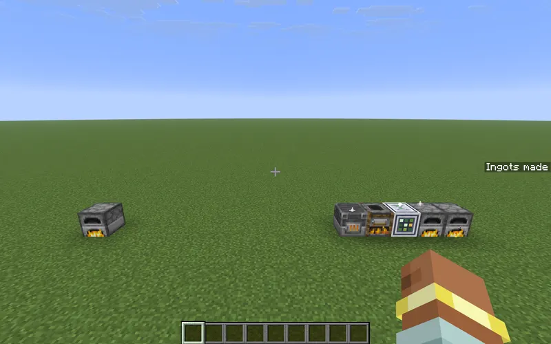
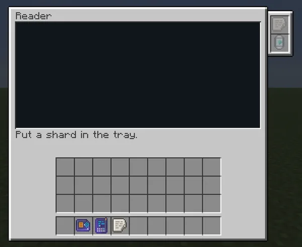

<div align="center">


**Rediscover the lost art of building intelligence from scratch.**

[Website](https://metrovoc.github.io/Residual/) · [Download](https://github.com/metrovoc/Residual/releases) · [Discord](https://discord.gg/UuV4hEYVFy)

</div>

> [!WARNING]
> Residual is an experimental project and currently in alpha. Expect breaking changes and major bugs. Your
> [feedback](https://github.com/metrovoc/Residual/issues) is much appreciated.


Someone lived in this world before you. They are no longer here, but traces of them still remain in the ruins. Most
mysteriously, they seemed to have built machines that thought.

Residual is a Minecraft mod about building those machines again, and every model you make with them is a real language
model. Each machine performs one real operation: a table lookup, a matrix multiplication, a softmax, a whole transformer
layer. Design the machines from the smallest operations there are, cable them into a network, train it, test it on what
it has never seen, and put it to work. A model that knows what the blocks around it will do next runs them ahead of time,
and agents run the programs you click together, with models where learning beats a rule. The arithmetic is what PyTorch
does, down to the optimizer.

## Why this project

Real systems are a lot of fun, but they often come with overwhelming complexity, some more accidental. This project aims to abstract that
complexity away at the right levels, to make a mod that is enjoyable and satisfying to play while staying faithful to
the essence of real systems.

## Machines from scratch


The machines that do the real computing, from the matrix multiplier to the transformer block, are made from designs
you wire yourself. On a Bench, a module is built from the smallest operations there are: add and multiply, exp and
log, a sum or a maximum along the last axis, a transpose. A spec says what the module must compute and checks it on
cases worked out exactly, among them the inputs that break the obvious design. Softmax wired straight from its formula
passes the ordinary cases and turns red on scores near 1000, where the exponential overflows; take each row's maximum
off first and it passes them all. Specs build on each other, from matrix multiply and softmax up to attention and a
whole transformer block.

A verified design is recorded onto a photomask, and a Fabricator makes machines from it. The ruins hold old photomasks
too, for anyone who would rather not wire everything themselves. Their designs are correct but written out one
operation at a time, so their machines give the same answers, use more memory and train more slowly.

The old world's last models seem to have kept the transformer's shape and changed what is inside it, a part at a time:
another norm, a gated layer, positions that turn instead of adding. Each part is a spec and a machine of its own, to try
and take out again, and the attention built for them works out its softmax as it goes, giving the same answers from about
a fiftieth of the memory.

## Models

<p>


</p>

Cable the machines together, and a Model Core trains them as one model, on up to four kinds of practice at once. It
shows the learning curves as they fall, every machine's output shape, its weights and its gradient.

While a model trains, waves run through its blocks: a teal pulse from the tokens to the loss as the batch goes forward,
then an amber one back as the gradient returns, each block lighting as brightly as what it carries. A block that stays
dark on the way back is hardly learning. Above every machine floats its output as a hologram, and an attention head
shows where each token looks.

Every model is tested on what practice never shows it, and a job asks its model in exactly the test's format, so a test
score is how often the model will get that job right. A single embedding table can forecast a furnace. Copying a build
takes two layers of attention. Understanding what you say takes a model too big to carry, until you train it in eight-bit
numbers.

The rest of a run is yours too: how the rate moves over thousands of steps, what the numbers are rounded to, what moves
the weights, how the text is cut into rows. Take the clip off at a high rate and you watch the loss spike. Round every
number to four bits and the model hardly learns; round them a block at a time and it learns almost as well as with
thirty-two.

One score is one run, and many a clever change sits within the noise. A Core can train a design again from five fresh
seeds and say whether your change moved the marks further than they spread by themselves, and a look-alike beside every
score shows whether the test got into the practice. Each model saved on a server goes on its leaderboards, so friends can
see who made what, at what score and what size.

## Running ahead

<p>


</p>

A Forecaster watches the furnaces, smokers, brewing stands and crops around it and writes down what each one does. A
model trained on lines like these is a small model of the world, and knows what those blocks will do next. The
Forecaster checks it against everything the blocks did by themselves, and if its forecasts hold, the Forecaster runs
them ahead, drawing each block's next moments from the model and making them so. A model that is wrong on average is
refused. Over one minute at four times the speed, a furnace beside a Forecaster made 24 iron ingots, and one out of its
reach made 6.

A machine keeps its pace, so a model of machines in general forecasts yours, and the first model you build, a single
embedding table, is enough. Crops are harder: the way to forecast your own field is to train on what the Forecaster saw
it do. Better models go further. Forecaster II runs blocks up to sixteen times as fast, and an Hourglass spends the time
it keeps on bursts for one block, wherever it is. Forecaster III keeps a store of power and spends it on thirty-second
bursts over everything around it that its model is trusted with, up to 256 times as fast.

## The Arena

A mob can be written down too. Carry a Mob Log while you fight something, and it keeps what each one around you did, look by
look. A model that practises on those lines learns how that kind fights. An Arena checks it on fights it has not read, then
lets it fight on the floor of a chamber for what the mob drops, from the game's own loot tables, with no mob anywhere and as
many fights at once as your compute carries. The closer it comes, the more it brings back: a thousand fights with a blaze
give no rods at the lowest tier and 1,955 at the highest.

## Agents

<p>


</p>

An agent is a frame that runs a program, such as `repeat (mine 4 stone, put)` or `take bread, come, give bread`, typed in
its screen or clicked together from a palette of pieces, and carried from agent to agent on Program Cards. Walking,
carrying, mining and laying blocks are its own. Wherever there is a real decision to make (which chest the iron went
into; what kind of thing this is; what you meant), it asks a model and does what the model answers. Its trace shows every
step it took, what it checked, and why a step failed. A model that passes its test at 98% decides right 98 times in 100.

The language goes as far as you take it: variables, lists, procedures, events and priorities, areas of nine shapes, and
filters on anything. Ports run it too, and a debugger steps through a program beside its trace, with breakpoints and the
values you are watching.

Say an order in chat, such as `Pip, bring me some bread`, and every agent named Pip within earshot hears it. Its model
writes the order as a program; anything longer than one step, or anything it isn't sure of, it reads back, and runs only
once you click Do it.

With a model that can carry on a pattern, an agent copies a build, moves it with everything inside, or keeps building
it. A Surveyor reads the ground around it with a model, and holding a Survey Rod near it shows you through the ground the
ores it found, and the chests and barrels the old world filled that nobody has opened. Tell an agent `mine 8 iron` and it
digs its way to them. Agents mining near each other each take a different block, so they work as a crew.

A Watch Post looks after the rest. It writes down what each machine and agent around it does, and its model, having
practised only on things going well, is surprised by what goes wrong: a furnace line that stopped, a farm growing slower,
an agent walking in circles. Then it raises a redstone signal, marks the thing, and tells anyone near.

## Storage

<p>


</p>

Residual keeps its own storage, with no channels and nothing to power. Storage Drives in a Drive Rack keep any number of
kinds of item and fluid, and Storage Links join them to Storage Terminals and Ports. A terminal shows everything the
network keeps and finds anything by name, mod, tag, tooltip or id: `@minecraft ingot -iron` finds every ingot but iron.
With a model that has learned what things are for, `?something to light a cave` finds what fits, though its name has no
word of what you wrote. A Port holds its front against a chest or a machine and imports, exports, keeps a set stock, or
opens the inventory to the network, moving 1,280 items a second. A Wireless Terminal reaches 528 blocks from an Access
Point, and with a Relay Card, anywhere the relays cover.

An Assembler crafts a recipe drawn in its grid from what the network keeps, and a Processor runs a furnace or any other
machine the same way. Ask a terminal for something they can make, and it plans the whole tree before anything starts:
what comes from storage, how many crafts make the rest, what is missing. A job can start with something missing and wait
for it, any number of jobs run at once, and Ports and agents can ask too. A Port with a model that has learned the rhythm
of what it moves asks ahead, before anything runs out.

## Power

A Combustion Generator burns furnace fuel, and Power Cables carry the power to Energy Cells and to the machines that run
on it. It is all Forge Energy, so it works with other mods' cables and machines. A Boiler and its Turbines get six times
as much from the same coal, and Solar Panels cost nothing to run. A reactor makes more than all of them together and will
not hold still: no rule keeps it running, and it starts only for a model that has learned to hold it.

The Smelter makes two ingots from every ore, and three when a model you trained keeps the melt at the right heat,
something it learned by playing melts of its own and learning from its choices. Tuned further, rewarded only for holding
the melt at one exact step of the heat, a model makes six.

## Compute

Training a model is multiplying numbers, and a Model Core counts them as it goes. What limits a run is how fast they go,
how much memory holds them and the energy each one takes, and all three depend on what you build. Accelerators come off
the Fabricator at a process node, from 90 nm down to 3 nm, and each node down holds eight times the memory, runs four
times as fast and takes half the energy for the same work. A model too big for the memory around it will not start.

Accelerators in Rack Modules make racks, racks make pods, and a run spreads across them on real threads by splitting the
data, the matrices or the layers, each way with its own speed-up and its own time lost waiting. Rows of racks make heat,
so a hall needs chillers, coolant and the power to run them, and you can read its load from one end of the room to the
other.

## The frame and the suit

A flight frame, worn on the back and charged from an Energy Cell, flies you as freely as creative play while its pilot
holds it steady: a model that learned to fly the frame on its own flights, reading its speed from the heights before and
meeting the wind before it pushes.

An exosuit carries a model on a board of its own, its numbers rounded to eight or four bits to fit, and what that model
can compute decides what the suit does: night vision, step assist, reach, a shield, vein mining of 64 blocks and more, and
flight twice as fast as the frame's. A model 64 wide at four bits runs all of it but the flight, and one 96 wide runs the
lot.

## The archive

<p>


</p>

The old world left its places behind: relay towers along the old roads, windmill farms on the ridges, stilt houses on
the marshes, slipways on the shores, inns and watermills, a market town's square, halls where minds were taught, a great
mine and an archive dug into a hill, sixteen kinds in all. Each is rare and stands only in the land that suits it, and a
Wayfinder leads to the nearest of any kind the archive has told you of. They hold archive shards, drives already full of
the old world's writing, the schematics of machines whose plans were lost, and salvaged models that no longer work.

A shard is one record of the old world's archive, a letter or a journal, a story, a song, a manual or a notice, with
some of its text worn away. Filed into an Archive Drive, what you recover becomes something to learn from: a model that
practises on it learns to read the way the old world wrote. A Reader restores lost text with a model of your own, and a
lost block comes back only if your model can predict it. Each restored block is more text to learn from.

Models start out reading one character at a time. A BPE Forge learns a vocabulary from the text you have recovered,
merging the most frequent pair of tokens over and over, and a model that reads with it sees words where it used to see
letters.

The boxes of fallen masts hold found drives as well, most of them no use as they lie: the same record sent again and again
until it was heard, lines garbled on the way, the line's own pulse between messages. A Refinery is a hall you build and
walk through, where the text crosses the air from machine to machine as lines you can read, fewer after each one, until
what is left lies in tanks of tokens a model can practise on. It can train a small reader on each cut, so you find out
what each machine was really worth.

## Serving models

<p align="center">

</p>

An agent carries a small model. A bigger one stays in a Model Server and answers over relays, anywhere they reach. Agents,
Terminals, Forecasters and Ports all take their turn at it, so its answers are a resource like any other: past 64
questions waiting it turns new ones away and its lights run red. Each answer costs what the model really computes. A
model 64 wide reads everything again for each new token and manages about four answers a second; a KV Cache that keeps
what it has read takes it to about 26, and its weights can be packed to a quarter of the room or less. Training
Accelerators give the Core more threads and the server more answers a second, and kept cool by water, ice or snow, they
work twice as hard.

Relays stacked make a mast that reaches up to 1,024 blocks. With a server answering fast enough and a model that
understands orders, Relay Gates move you between them, even across dimensions, and links make the storage and power at
both ends of the world one. A Terminal shows the network on a map, reads stock and machines from anywhere it covers, runs
programs, carries your orders, and lets you write with the served model.

## After practice

A model that has finished practising can still be changed. A Tuner leaves a saved model as it is and makes a new one from
it: fine-tuned on instructions, holding a second job beside its first, tuned on your own choices between two answers, or
rewarded for programs a sandbox has run to see whether they work. Reward the wrong thing and you can watch it go wrong:
mark a program only for failing nowhere, and in 150 steps the reward goes from 88% to 98% while what is really right falls
from 73% to 48%.

A server can also think longer. It writes many answers to a question and keeps one, and if a good answer can be told from
a bad one, the extra tries are worth paying for. Given 64 answers to a sum, the commonest is right 15% of the time, and one
whose every step checks is right 68%.

## Looking inside

A test tells you what a model can do and nothing of how it does it. A Stream Scope opens one you trained: what each layer
would answer if it had to answer now, what a probe can read from the stream beside what a control reads, what happens when
you patch one run into another or steer it by hand, what features a sparse autoencoder finds, and which parts an answer
really came through, by knocking each one out. Some things happen only while a model trains, and a milestone marks them
when they really do: an induction head forming, or a small model that had only memorised its sums suddenly understanding
them.

A Trial Rig does what goes wrong with models on purpose, to a copy of yours, for real: getting its practice back out of it
word for word, planting a word that survives clean tuning, making it forget, and training each generation only on what the
last one wrote, and watching its words fall apart.

## Real models

Residual trains with its own reverse-mode autograd engine, written in Java to match PyTorch operation for operation,
and with the same optimizers: AdamW with gradient clipping and a short warmup, and Muon beside it. Every operation's output
and gradients, and the optimizer's steps, are tested against reference values computed once with PyTorch
(`TorchParityTest`), and every gradient against numerical differentiation (`OpsGradientTest`). Nothing of PyTorch ships with
the mod.

A two-layer GPT with four attention heads and a 64-wide residual stream has 115,161 parameters. Trained for 4,000 steps
on the text shards can carry, it reaches a loss of 1.34 on records it never saw, and the Reader restores 88% of the lost
blocks it is given.

## Install

Residual needs Minecraft 26.1.2, NeoForge 26.1.2.124 or newer, and [GuideME](https://modrinth.com/mod/guideme)
26.1.16-beta or newer. Put the jar from [Releases](https://github.com/metrovoc/Residual/releases) in your `mods` folder
next to GuideME.

You get the field notes the first time you join a world, and they are also
[online](https://metrovoc.github.io/Residual/). Hold **G** over any Residual item to open its page.

### Modpack

`Residual-0.5.0-alpha.mrpack`, also on the Releases page, sets up Residual with Applied Energistics 2, JEI, Jade, Sodium,
ModernFix and FerriteCore. Import it in Prism Launcher or the Modrinth App.

## Building

Building needs Java 25.

```sh
./gradlew build       # build/libs/residual-26.1.2-0.5.0-alpha.jar
./gradlew runClient
```

The textures, the JSON data, the ruins and the guide's formula images are generated by the scripts in `tools`, and
their output is checked in. After changing a script, run it with [uv](https://docs.astral.sh/uv/):

```sh
uv run --with pillow python tools/art.py
uv run python tools/data.py
uv run --with matplotlib python tools/formulas.py
```

`uv run python tools/pack.py` builds the modpack around the jar in `build/libs`, and `./gradlew guideWebsite` builds
the field notes as a website in `build/guideWebsite`.

## Credits

The guide runs on [GuideME](https://github.com/AppliedEnergistics/GuideME).

## License

[MIT](LICENSE)
