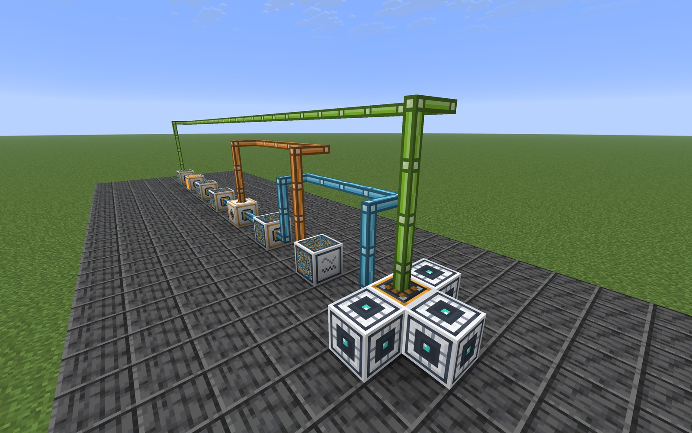
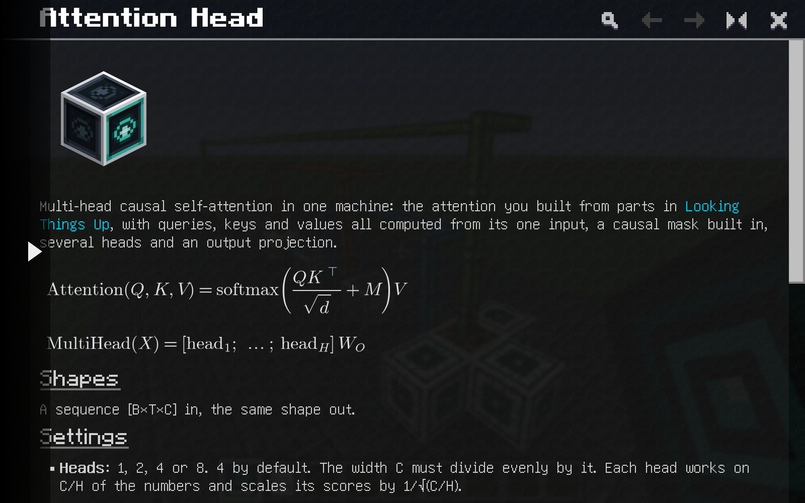
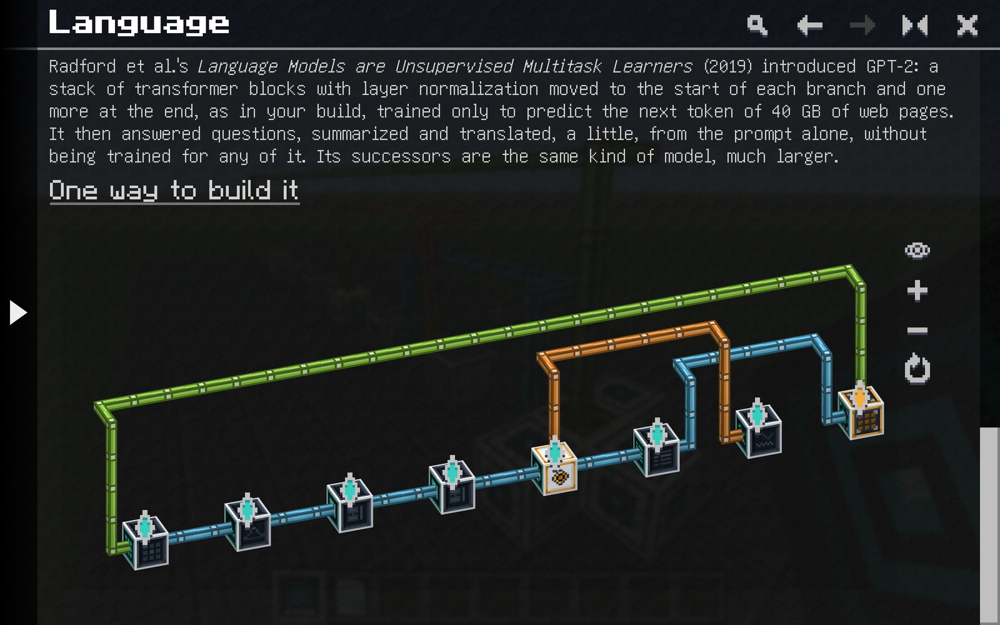
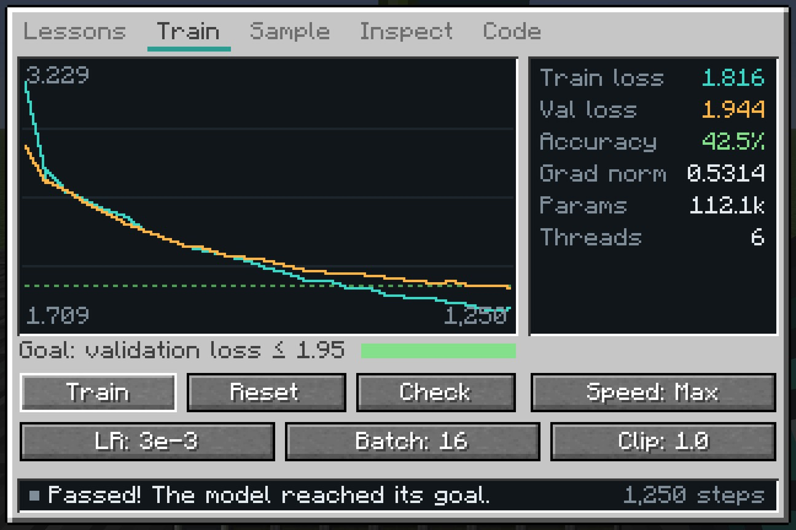
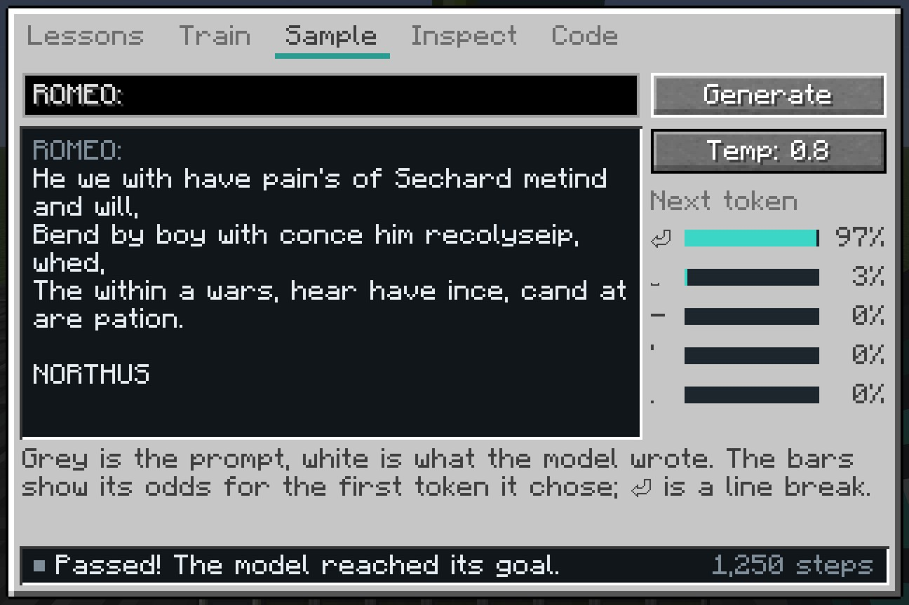
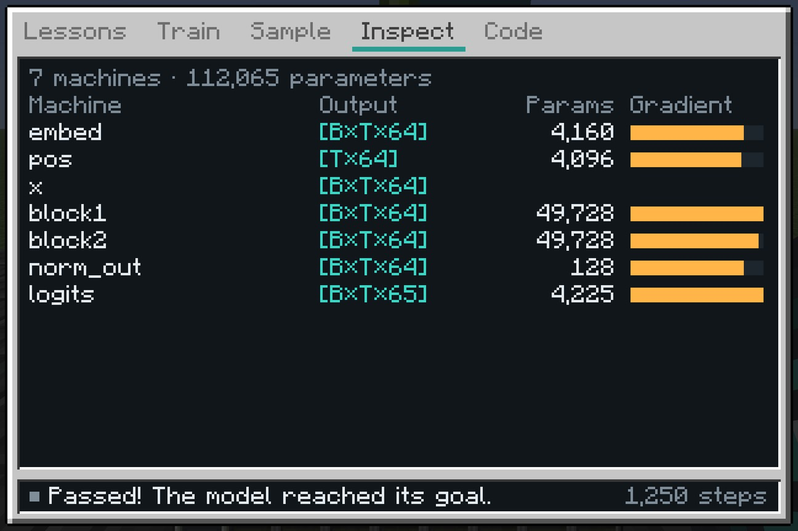
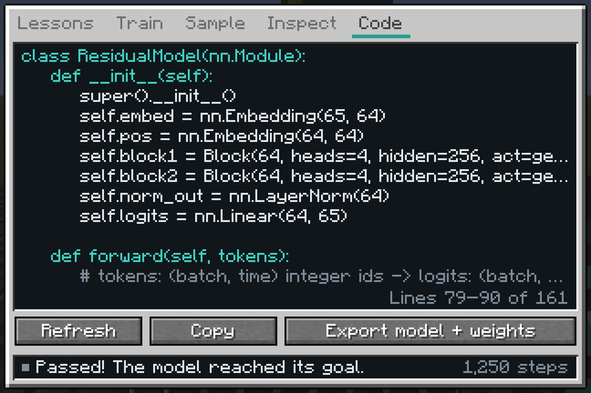

<div align="center">


**Build a language model from the ground up, one block at a time.**

</div>



Residual is a Minecraft mod that turns the inside of a language model into machines. Each machine performs one real
operation: a table lookup, a matrix multiplication, a softmax, a whole transformer layer. Cable them together, connect
the result to a Model Core, and train it on text while you watch the loss fall. The arithmetic is what PyTorch does,
down to the optimizer, and every model you build can leave the game as a PyTorch module with its trained weights.

## Learn by building

Six lessons retrace how language models came to be, each after a paper. A lesson is done when your model reaches its
goal on held-out text, or on fresh puzzles.

|   | Lesson            | What you build                                            | Paper                          |
| - | ----------------- | --------------------------------------------------------- | ------------------------------ |
| 1 | Counting Pairs    | a table that scores the next letter from the last one     | Shannon, 1948                  |
| 2 | More Context      | embeddings and a hidden layer over the last three letters | Bengio et al., 2003            |
| 3 | Looking Things Up | attention, assembled by hand, to recall a digit           | Bahdanau, Cho and Bengio, 2014 |
| 4 | Knowing Where     | positions and a transformer layer that reverses digits    | Vaswani et al., 2017           |
| 5 | Induction Heads   | two attention layers that continue a repeated run         | Olsson et al., 2022            |
| 6 | Language          | a small GPT that writes Shakespeare                       | Radford et al., 2019           |

Between the lessons, five cases hand you a model that is broken the way real models break and leave the diagnosis to
you: one that won't start, one whose loss explodes, one that scores too well to be true, one that can't reverse a
string, and one too deep to learn. Every lesson awards an Insight, which unlocks the recipes of new machines.

<p>


</p>

The in-game guide has a page for every machine, lesson and case, with the formulas, the shapes, the PyTorch each
machine stands for, and 3D scenes of reference builds that you can turn and zoom.

## The Model Core

<p>


</p>
<p>


</p>

The Core feeds text into your machines and judges the scores that come back. It has five tabs:

- **Lessons**: the course in order. Load a lesson, or build a case's broken model in front of the Core.
- **Train**: the learning curve against the goal, the latest loss, accuracy and gradient norm, and the settings:
  learning rate, batch size, gradient clipping and speed.
- **Sample**: type the start of something and the model continues it, or watch it answer fresh puzzles.
- **Inspect**: every machine in the order data reaches it, with its output shape, weights and last gradient.
- **Code**: the model as a PyTorch module, generated from your machines.

Each Training Accelerator touching the Core lends it another thread. The machines show their work too: the front of
each one displays its latest output, and the sides of machines that learn display their main weight matrix.

## Real models

Residual trains with its own reverse-mode autograd engine, written in Java to match PyTorch operation for operation,
and with the same optimizer: AdamW with gradient clipping and a short warmup. A parity test replays the lessons'
reference models and a model that uses every machine in PyTorch, and compares the logits, the loss, every gradient,
and the weights after several optimizer steps. CI runs it on every push.

The Language lesson's model is a two-layer GPT with four attention heads, a 64-wide residual stream and 112,065
parameters. With four Training Accelerators, on six threads of an Apple M5 Pro, it reaches its goal, a validation loss
of 1.95, in under two minutes.

**Export model + weights** on the Code tab writes `model.py` and `weights.bin` to `residual/exports` in your game
folder. With PyTorch installed, the model runs outside the game:

```sh
python model.py "ROMEO:"
```

## Install

Residual needs Minecraft 26.1.2, NeoForge 26.1.2.124 or newer, and [GuideME](https://modrinth.com/mod/guideme)
26.1.16-beta or newer. Put the jar from [Releases](https://github.com/metrovoc/Residual/releases) in your `mods` folder
next to GuideME.

You get the guide the first time you join a world. The **?** button on the Model Core opens it at the selected
lesson's page.

### Modpack

`Residual-1.0.0.mrpack`, also on the Releases page, sets up Residual with Applied Energistics 2, JEI, Jade, Sodium,
ModernFix and FerriteCore. Import it in Prism Launcher or the Modrinth App.

## Building

Building needs Java 25.

```sh
./gradlew build       # build/libs/residual-26.1.2-1.0.0.jar
./gradlew runClient
```

The textures, the JSON data and the guide's formula images are generated by the scripts in `tools`, and their output
is checked in. After changing a script, run it with [uv](https://docs.astral.sh/uv/):

```sh
uv run --with pillow python tools/art.py
uv run python tools/data.py
uv run --with matplotlib python tools/formulas.py
```

The PyTorch parity test:

```sh
RESIDUAL_PARITY_DIR=build/parity ./gradlew test --tests '*PyTorchParityTest*'
uv run --no-project --with torch --with numpy python src/test/python/parity.py build/parity
```

`uv run python tools/pack.py` builds the modpack around the jar in `build/libs`.

## Credits

- The word lessons read a sample of the word list from *Webster's Second International Dictionary* (1934), which is
  in the public domain.
- The Language lesson reads Tiny Shakespeare, the corpus Andrej Karpathy assembled for char-rnn.
- The guide runs on [GuideME](https://github.com/AppliedEnergistics/GuideME).

## License

[MIT](LICENSE)
