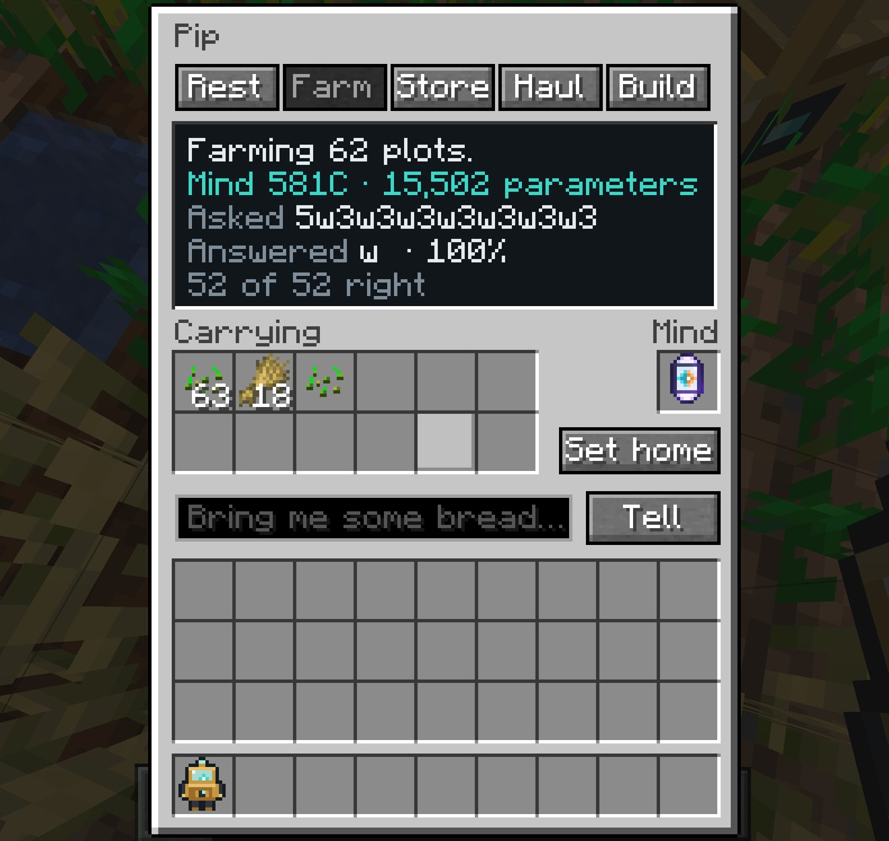

<div align="center">


**Build minds from the ground up, one block at a time.**

</div>


Someone lived in this world before you. They built machines that thought, and they wrote everything down. Then they
were gone, and nothing they left says why. Their writing survives in the ruins as broken shards.

Residual is a Minecraft mod about building those minds again, and every mind is a real language model. Each machine
performs one real operation: a table lookup, a matrix multiplication, a softmax, a whole transformer layer. Cable
machines into a network, train it on text, test it on text it has never seen, and put it to work in the body of an
apprentice. The arithmetic is what PyTorch does, down to the optimizer, and every mind can leave the game as a PyTorch
module with its trained weights.

## The archive

<p>


</p>

Archive houses, relay masts and buried vaults stand far apart across the overworld. They hold archive shards, the
schematics of machines whose plans were lost, and salvaged minds that no longer work.

A shard is one record of the old world's archive, a letter or a journal, a story, a song, a manual or a notice, with
some of its text worn away. Filed into an Archive Drive, what you recover becomes something to learn from: a mind that
practises on it learns to read the way the old world wrote. A Reader restores lost text with a mind of your own, and a
lost block comes back only if your mind can predict it. Each restored block is more text to learn from.

## Minds

<p>


</p>

Every mind is tested on six abilities. A test uses examples that practice never shows, and a job asks its mind in
exactly the test's format, so a test score is how often an apprentice decides right.

| Ability   | Practice      | Passes at   | Put to work                  |
| --------- | ------------- | ----------- | ---------------------------- |
| Reacting  | Field Drill   | 98%         | farming                      |
| Recall    | Storage Drill | 90%         | keeping a storeroom          |
| Reversal  | Errand Drill  | 90%         | hauling                      |
| Induction | Pattern Drill | 90%         | building                     |
| Orders    | Orders Drill  | 90%         | understanding what you say   |
| Reading   | Archive Drive | loss ≤ 1.70 | restoring the archive        |

A single embedding table can learn to farm. Recall needs attention, reversal needs to know positions, induction takes
two layers of attention, and understanding orders takes a mind too big to carry. The Model Core trains a mind on up to
four kinds of practice at once and shows the learning curves, the tests, every machine's output shape, weights and
gradient, and the mind as PyTorch code. Saving a mind to a checkpoint tests it on all six abilities first.

## Apprentices

<p>


</p>

An apprentice is a body for a mind. It walks, reaps, carries and lays blocks on its own. Whenever there is a real
decision to make (harvest, wait or plant; which chest the iron went into; the way home; the next block of a pattern;
what you meant), it asks its mind in the format of the test and does what the mind answers. Its screen shows the
question, the answer and how sure the mind was. A mind that passes its test at 98% decides right 98 times in 100.

Say an order in chat, such as `Pip, bring me some bread`, and every apprentice named Pip within earshot hears it.

## Serving minds

An apprentice carries a mind of up to 40,000 parameters. A bigger mind stays in a Model Server and answers over relays.
A Relay Card in an apprentice's mind slot asks the server instead, anywhere the relays reach. A Terminal lets you write
with the served mind and carries your orders as far as the relays go. Training Accelerators give the Core more threads
and the server more answers a second; kept cool by water, ice or snow, they work twice as hard.

## Real models

Residual trains with its own reverse-mode autograd engine, written in Java to match PyTorch operation for operation,
and with the same optimizer: AdamW with gradient clipping and a short warmup. A parity test replays reference models and
a model that uses every machine in PyTorch, and compares the logits, the loss, every gradient, and the weights after
several optimizer steps. CI runs it on every push.

A two-layer GPT with four attention heads and a 64-wide residual stream has 113,742 parameters. Trained on every record
a shard can carry, it reaches a loss of 1.37 on records it never saw, and the Reader restores 86% of the lost blocks it
is given.

**Export model + weights** on the Code tab writes `model.py` and `weights.bin` to `residual/exports` in your game
folder. With PyTorch installed, the model runs outside the game:

```sh
python model.py "Dear Sefa,"
```

## Install

Residual needs Minecraft 26.1.2, NeoForge 26.1.2.124 or newer, and [GuideME](https://modrinth.com/mod/guideme)
26.1.16-beta or newer. Put the jar from [Releases](https://github.com/metrovoc/Residual/releases) in your `mods` folder
next to GuideME.

You get the field notes the first time you join a world. Hold **G** over any Residual item to open its page.

### Modpack

`Residual-2.0.0.mrpack`, also on the Releases page, sets up Residual with Applied Energistics 2, JEI, Jade, Sodium,
ModernFix and FerriteCore. Import it in Prism Launcher or the Modrinth App.

## Building

Building needs Java 25.

```sh
./gradlew build       # build/libs/residual-26.1.2-2.0.0.jar
./gradlew runClient
```

The textures, the JSON data, the ruins and the guide's formula images are generated by the scripts in `tools`, and
their output is checked in. After changing a script, run it with [uv](https://docs.astral.sh/uv/):

```sh
uv run --with pillow python tools/art.py
uv run python tools/data.py
uv run --with matplotlib python tools/formulas.py
```

The PyTorch parity test:

```sh
RESIDUAL_PARITY_DIR=$PWD/build/parity ./gradlew test --rerun --tests '*PyTorchParityTest*'
uv run --no-project --with torch --with numpy python src/test/python/parity.py build/parity
```

`uv run python tools/pack.py` builds the modpack around the jar in `build/libs`.

## Credits

The machines are built on these ideas:

- Claude Shannon, *A Mathematical Theory of Communication*, 1948.
- Yoshua Bengio, Réjean Ducharme, Pascal Vincent and Christian Jauvin, *A Neural Probabilistic Language Model*, 2003.
- Diederik Kingma and Jimmy Ba, *Adam: A Method for Stochastic Optimization*, 2014.
- Dzmitry Bahdanau, Kyunghyun Cho and Yoshua Bengio, *Neural Machine Translation by Jointly Learning to Align and
  Translate*, 2014.
- Kaiming He, Xiangyu Zhang, Shaoqing Ren and Jian Sun, *Deep Residual Learning for Image Recognition*, 2015.
- Jimmy Lei Ba, Jamie Ryan Kiros and Geoffrey Hinton, *Layer Normalization*, 2016.
- Dan Hendrycks and Kevin Gimpel, *Gaussian Error Linear Units (GELUs)*, 2016.
- Ashish Vaswani et al., *Attention Is All You Need*, 2017.
- Ilya Loshchilov and Frank Hutter, *Decoupled Weight Decay Regularization*, 2017.
- Alec Radford et al., *Language Models are Unsupervised Multitask Learners*, 2019.
- Biao Zhang and Rico Sennrich, *Root Mean Square Layer Normalization*, 2019.
- Catherine Olsson et al., *In-context Learning and Induction Heads*, 2022.

The guide runs on [GuideME](https://github.com/AppliedEnergistics/GuideME).

## License

[MIT](LICENSE)
