<div align="center">


**Rediscover the lost art of building intelligence from scratch.**

[Website](https://metrovoc.github.io/Residual/) · [Download](https://github.com/metrovoc/Residual/releases) · [Discord](https://discord.gg/UuV4hEYVFy)

</div>

> [!WARNING]
> Residual is an experimental project and currently in alpha. Expect breaking changes and major bugs. Your
> [feedback](https://github.com/metrovoc/Residual/issues) is much appreciated.

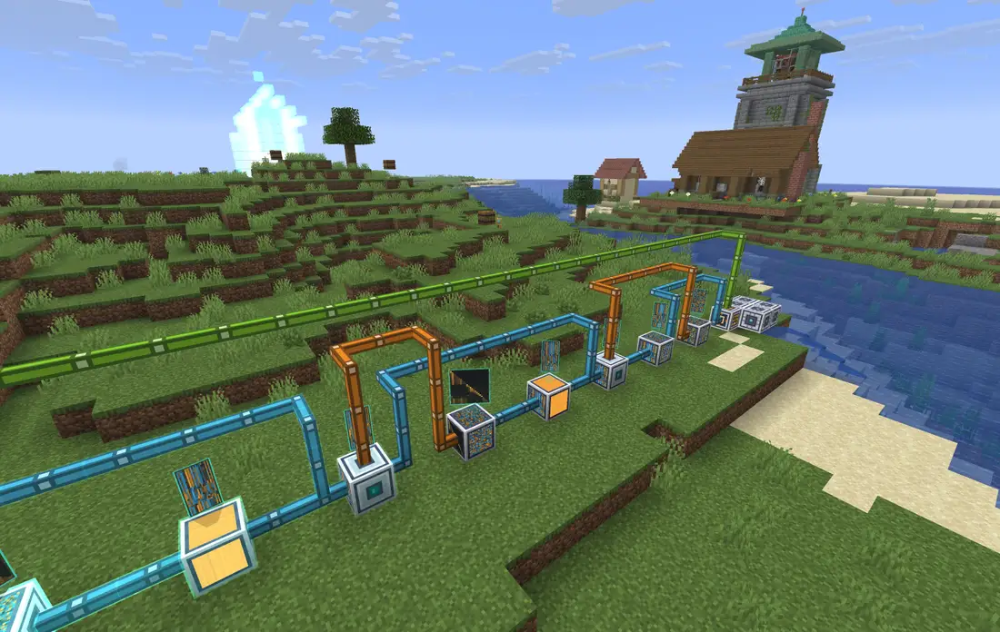

Someone lived in this world before you. They built machines that thought, and they wrote everything down. Then they
were gone. But there still seem to be pieces of it in the ruins.

Residual is a Minecraft mod about building those models again, and every model is a real language model. Each machine
performs one real operation: a table lookup, a matrix multiplication, a softmax, a whole transformer layer. Design the
machines from the smallest operations there are, cable them into a network, train it, test it on what it has never
seen, and put it to work: a model that knows what the blocks around it will do next runs them ahead of time, and agents
run the programs you click together, with models where learning beats a rule. The arithmetic is what PyTorch does, down
to the optimizer.

## Why this project

Real systems are a lot of fun, but they often come with overwhelming complexity, some more accidental. This project aims to abstract that
complexity away at the right levels, to make a mod that is enjoyable and satisfying to play while staying faithful to
the essence of real systems.

## Machines from scratch

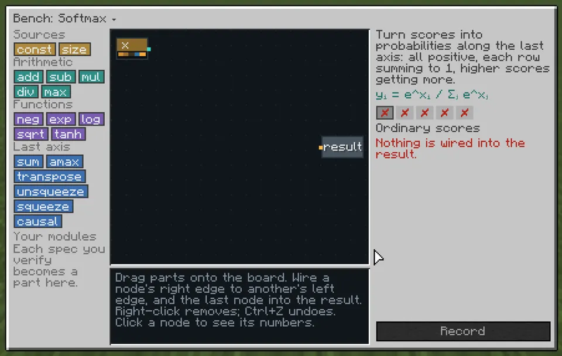

The machines that do the real computing, from the matrix multiplier to the transformer block, are made from designs
you wire yourself. On a Bench, a module is built from the smallest operations there are: add and multiply, exp and
log, a sum or a maximum along the last axis, a transpose. A spec says what the module must compute and checks it on
cases worked out exactly, among them the inputs that break the obvious design. Softmax wired straight from its formula
passes the ordinary cases and turns red on scores near 1000, where the exponential overflows; take each row's maximum
off first and it passes them all. Specs build on each other, from matrix multiply and softmax up to attention and a
whole transformer block.

A verified design is recorded onto a photomask, and a Fabricator makes machines from it out of wafers, a smaller
design costing fewer. The ruins hold old photomasks too. Their designs are correct but written out one operation at a
time: their machines give the same answers, use more memory and train more slowly.

## Running ahead

<p>
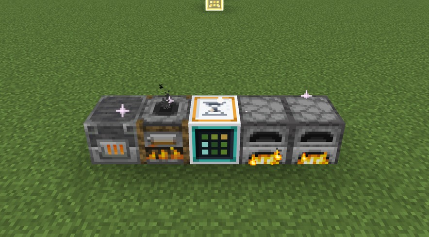
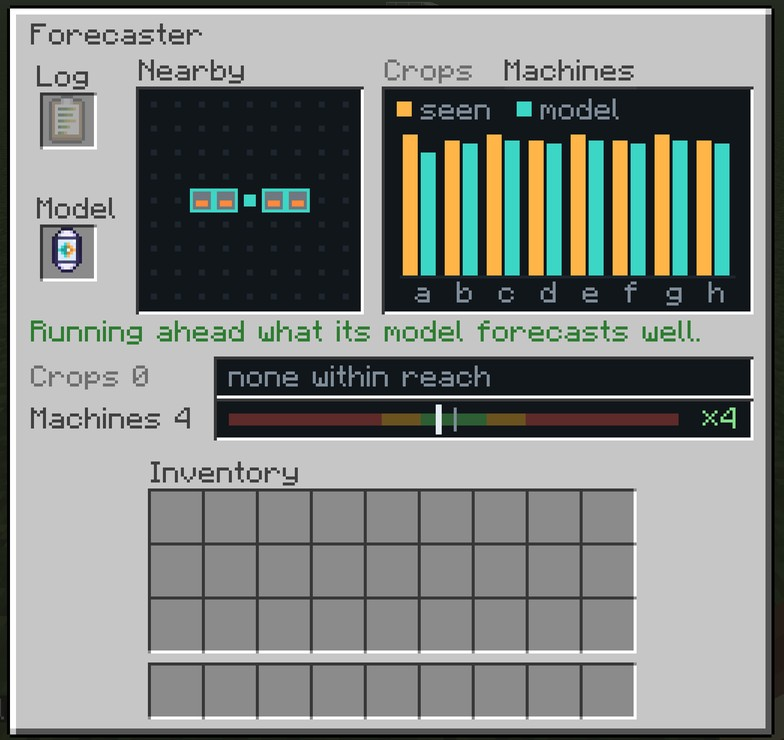
</p>

A Forecaster watches the furnaces, smokers, blast furnaces, brewing stands and crops around it and writes down what
each one does, a line per block: a furnace's progress through its item, eight looks an item, or a crop's age every
twenty seconds. A model trained on lines like these is a small model of the world, and knows what those blocks will do
next. The Forecaster checks it against everything the blocks did by themselves. If the progress the model expects is
within 11% of the progress there was, the Forecaster runs them four looks for every one, drawing each block's next
looks from the model and making them so; within 25%, two. A model that is wrong on average is refused. Over one minute
at ×4, a furnace beside a Forecaster made 24 iron ingots and one out of its reach made 6.

A machine keeps its pace, so a model of machines in general forecasts yours, and the first model you build, a single
embedding table, is enough. Crops are harder: a model of fields in general expects an average field, so the way to
forecast yours is to train on the Forecaster's own log.

## Agents

<p>
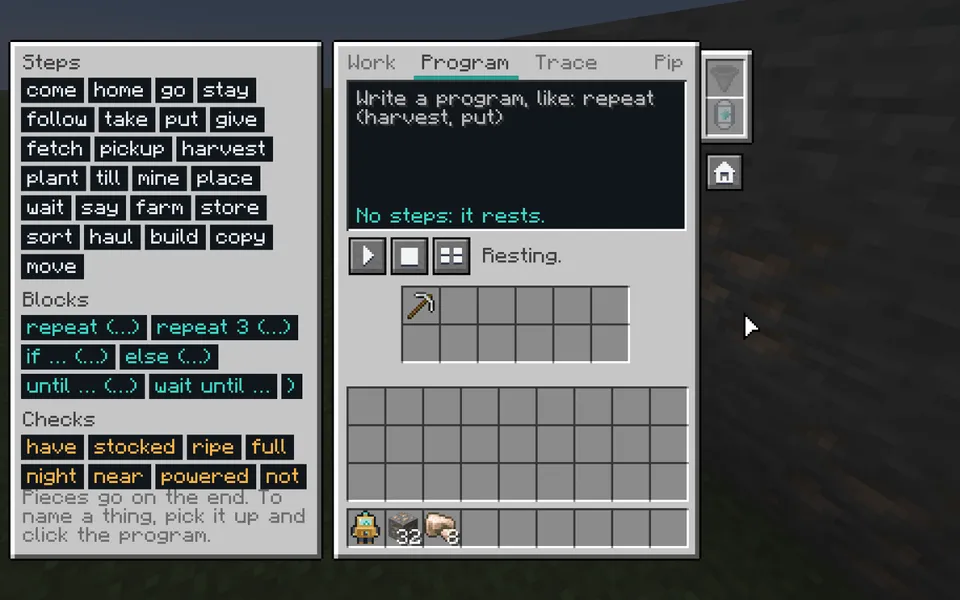
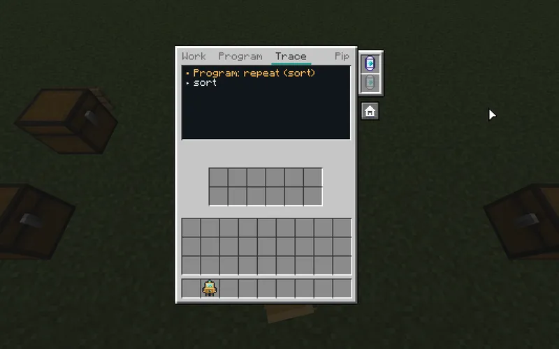
</p>

An agent is a frame that runs a program, such as `repeat (mine 4 stone, put)` or `take bread, come, give bread`,
typed in its screen or clicked together from a palette of pieces, checked as you go, and carried from agent to agent on
Program Cards. Walking, carrying, mining and laying blocks are its own. Wherever there is a real decision to make (which
chest the iron went into; the way home; the next block of a pattern; what kind of thing this is; what you meant), it
asks a model in the format of the test and does what the model answers. Its trace shows every step it took, what it checked, and why a step failed. A model that passes its test at 98%
decides right 98 times in 100.

Besides its model, an agent carries a filter: a model that tells what kind a thing is from its name alone, so that
`sort` can file things it has never seen into chests labelled Food, Wood or Ores.

Say an order in chat, such as `Pip, bring me some bread`, and every agent named Pip within earshot hears it. Its model
writes the order as a program; anything longer than one step it reads back, and runs only once you click Do it.

## Storage

<p>
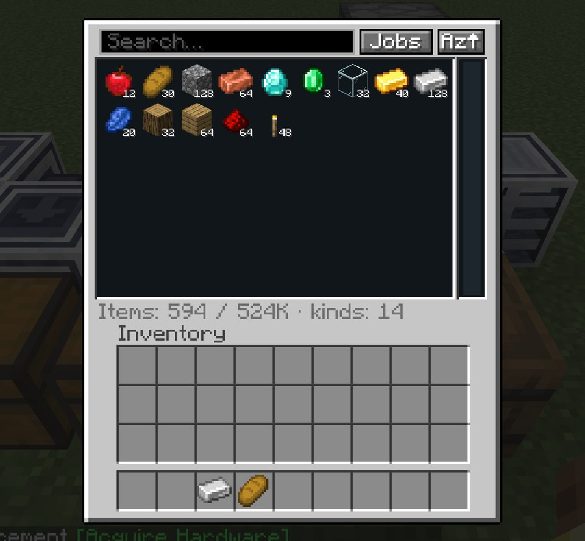
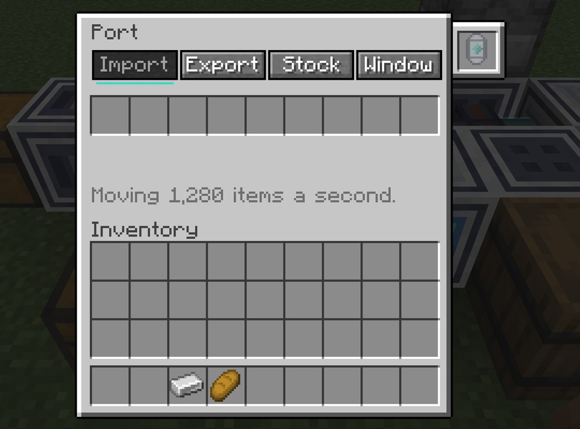
</p>

Storage Drives in a Drive Rack keep any number of kinds of item, 262,144 items to a drive, and Storage Links join them
to Storage Terminals and Ports. There are no channels and nothing to power. A terminal shows everything the network
keeps and finds anything by name, mod, tag, tooltip or id, with `-` to leave things out, `|` for alternatives,
parentheses and amounts: `@minecraft ingot -iron` finds every ingot but iron. A Port holds its front against a chest or
a machine and imports, exports, keeps a set stock, or opens the inventory to the network as a window, 64 items a tick:
with its chest refilled every tick, one moved 1,280 items a second. An Assembler crafts a recipe drawn in its grid from
what the network keeps, up to 80 crafts a second, whenever the network holds fewer of the result than it is told to
keep, so one that keeps sticks lets another make torches for as long as there is coal. Ask a terminal for something the
Assemblers can make, and it plans the whole tree off the server thread before anything starts: what comes from storage,
how many crafts make the rest, what is missing. A job can start with something missing and wait for it, any number of
jobs run at once, and what a job makes along the way is its own until it is done.

## The archive

<p>
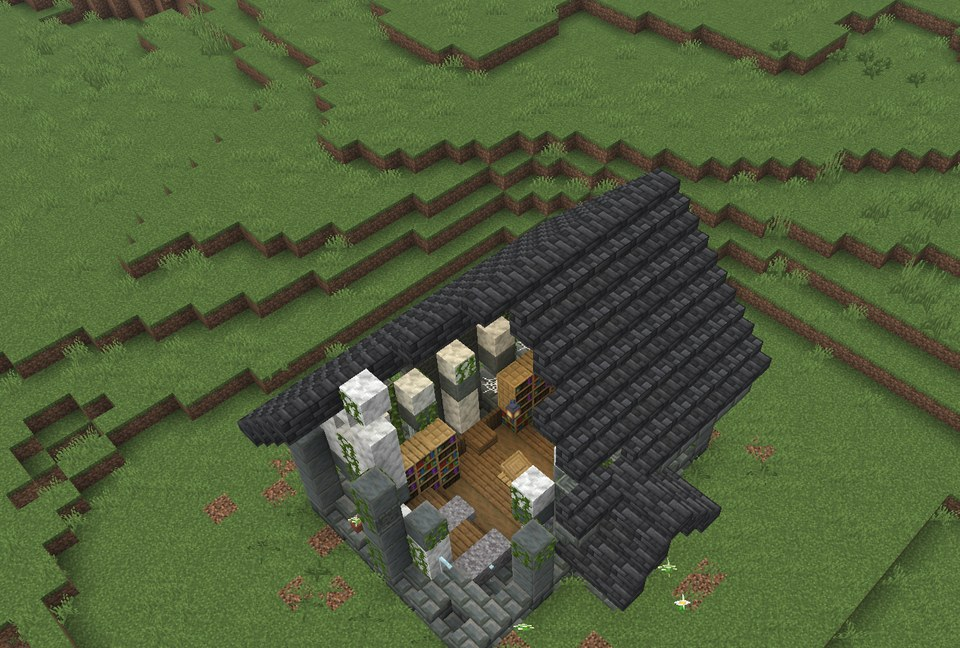
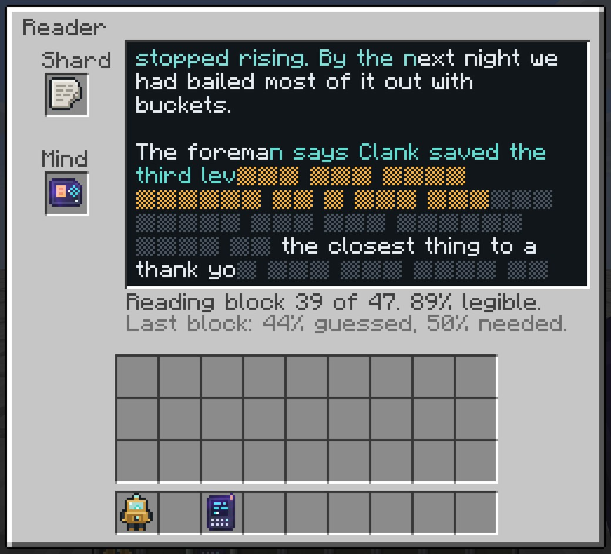
</p>

Archive houses, relay masts and buried vaults stand far apart across the overworld. They hold archive shards, the
schematics of machines whose plans were lost, and salvaged models that no longer work.

A shard is one record of the old world's archive, a letter or a journal, a story, a song, a manual or a notice, with
some of its text worn away. Filed into an Archive Drive, what you recover becomes something to learn from: a model that
practises on it learns to read the way the old world wrote. A Reader restores lost text with a model of your own, and a
lost block comes back only if your model can predict it. Each restored block is more text to learn from.

Models start out reading one character at a time. A BPE Forge learns a vocabulary from the text you have recovered,
merging the most frequent pair of tokens over and over, and writes it onto a Tokenizer. A model that reads with it sees
words where it used to see letters. Losses are counted per character, so models with different tokenizers compare
fairly.

## Models

<p>
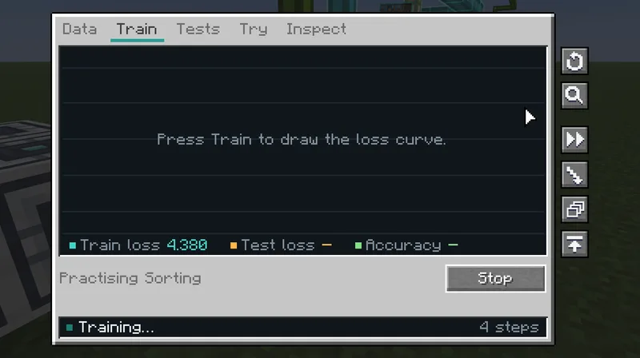
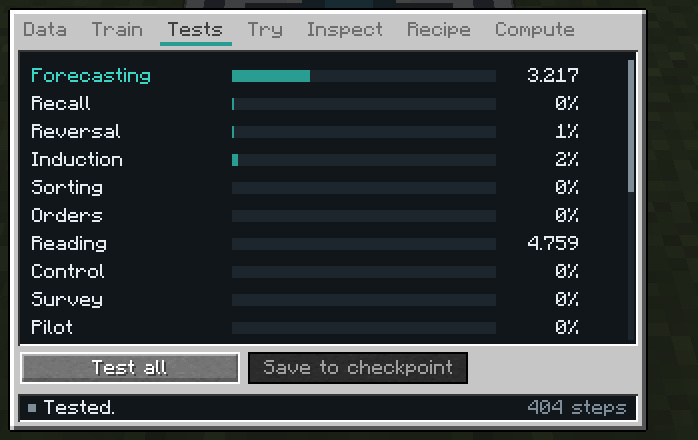
</p>

Every model is tested on seven benchmarks. A test uses examples that practice never shows, and a job asks its model in
exactly the test's format, so a test score is how often an agent decides right.

| Benchmark   | Practice      | Passes at   | Put to work                  |
| --------- | ------------- | ----------- | ---------------------------- |
| Forecasting | Forecast Dataset | loss ≤ 0.21 | running blocks ahead         |
| Recall    | Storage Dataset | 90%         | keeping a storeroom          |
| Reversal  | Errand Dataset  | 90%         | hauling                      |
| Induction | Pattern Dataset | 90%         | building                     |
| Sorting   | Sorting Dataset | 90%         | sorting things by kind       |
| Orders    | Orders Dataset  | 90%         | understanding what you say   |
| Reading   | Archive Drive | loss ≤ 1.40 | restoring the archive        |

A single embedding table can forecast a furnace. Recall needs attention, reversal needs to know positions, induction takes
two layers of attention, sorting has to tell what a thing is from its name alone, and understanding orders takes a model
too big to carry. The Model Core trains a model on up to four kinds of practice at once and shows the learning curves,
the tests, every machine's output shape, weights and gradient. Saving a model to a checkpoint tests it on all seven
benchmarks first.

While a model trains, waves run through its blocks: a teal pulse from the tokens to the loss as the batch goes forward,
then an amber one back as the gradient returns, each block lighting as brightly as what it carries. A block that stays
dark on the way back is hardly learning. Above every machine floats its output as a hologram, and an attention head
shows where each token looks.

## Serving models

<p align="center">
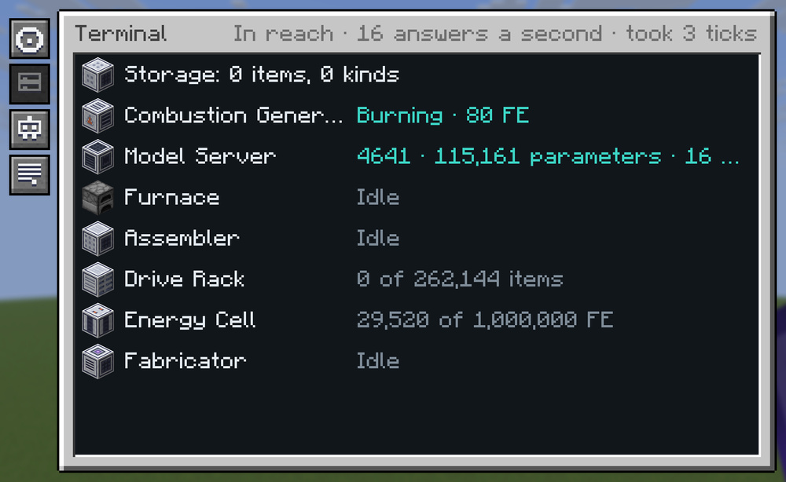
</p>

An agent carries a model of up to 40,000 parameters. A bigger model stays in a Model Server and answers over relays.
A Relay Card in an agent's model slot asks the server instead, anywhere the relays reach. A Terminal lets you write
with the served model and carries your orders as far as the relays go. Training Accelerators give the Core more threads
and the server more answers a second; kept cool by water, ice or snow, they work twice as hard.

## Real models

Residual trains with its own reverse-mode autograd engine, written in Java to match PyTorch operation for operation,
and with the same optimizer: AdamW with gradient clipping and a short warmup. Every operation's output and gradients,
and the optimizer's steps, are tested against reference values computed once with PyTorch (`TorchParityTest`), and
every gradient against numerical differentiation (`OpsGradientTest`). Nothing of PyTorch ships with the mod.

A two-layer GPT with four attention heads and a 64-wide residual stream has 113,742 parameters. Trained on every record
a shard can carry, it reaches a loss of 1.37 on records it never saw, and the Reader restores 86% of the lost blocks it
is given.

## Install

Residual needs Minecraft 26.1.2, NeoForge 26.1.2.124 or newer, and [GuideME](https://modrinth.com/mod/guideme)
26.1.16-beta or newer. Put the jar from [Releases](https://github.com/metrovoc/Residual/releases) in your `mods` folder
next to GuideME.

You get the field notes the first time you join a world, and they are also
[online](https://metrovoc.github.io/Residual/). Hold **G** over any Residual item to open its page.

### Modpack

`Residual-0.4.0-alpha.mrpack`, also on the Releases page, sets up Residual with Applied Energistics 2, JEI, Jade, Sodium,
ModernFix and FerriteCore. Import it in Prism Launcher or the Modrinth App.

## Building

Building needs Java 25.

```sh
./gradlew build       # build/libs/residual-26.1.2-0.4.0-alpha.jar
./gradlew runClient
```

The textures, the JSON data, the ruins and the guide's formula images are generated by the scripts in `tools`, and
their output is checked in. After changing a script, run it with [uv](https://docs.astral.sh/uv/):

```sh
uv run --with pillow python tools/art.py
uv run python tools/data.py
uv run --with matplotlib python tools/formulas.py
```

`uv run python tools/pack.py` builds the modpack around the jar in `build/libs`, and `./gradlew guideWebsite` builds
the field notes as a website in `build/guideWebsite`.

## Credits

The guide runs on [GuideME](https://github.com/AppliedEnergistics/GuideME).

## License

[MIT](LICENSE)
